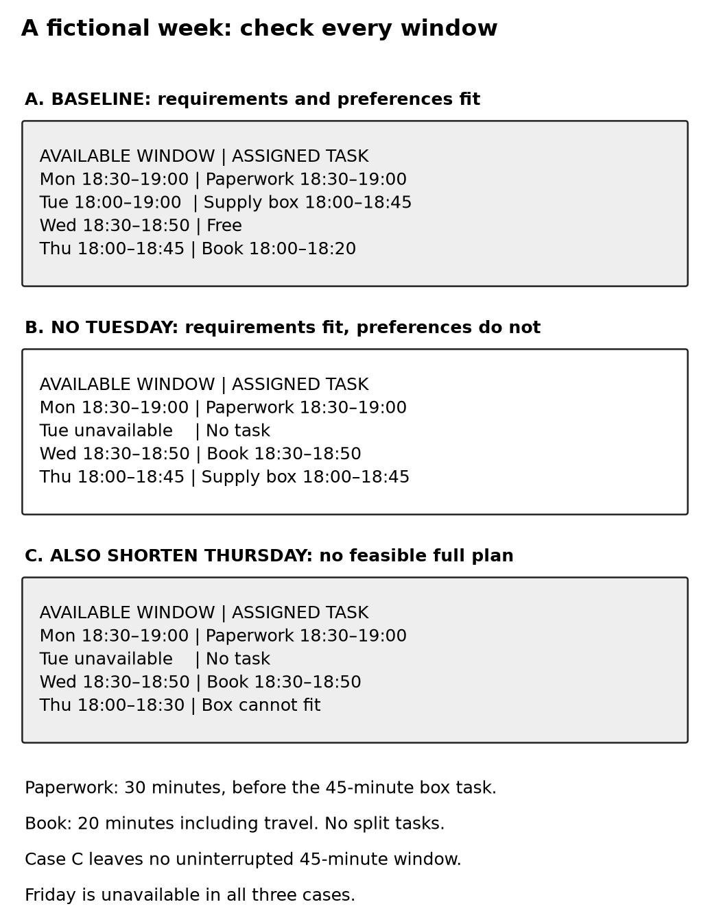

# Chapter 1 practice guide

Give Claude one useful job

## Objective

Define a bounded task, distinguish requirements from preferences, and check a plan against both.

## Inputs

- [Everyday collaboration and repair](../collaboration-lab/README.md)
- [Help building a prompt](../prompt-builder/README.md)
- [Connected personal practice](../growth-lab/personal/README.md)
- [practice-week.txt](../chapter-01/practice-week.txt)

## Practice and assessment

Now remove Tuesday's free hour. Ask Claude to revise the plan without changing the task durations or deadlines.

What happens to your wish to keep Wednesday free?

The paperwork can still happen Monday. The library return can use Wednesday's twenty minutes, and the supply box can use Thursday's forty-five minutes. The required work fits, but every available evening now has a task. A useful response should make that tradeoff visible. You can then decide whether to accept it or change the week.

Try one more change: Thursday now has only thirty minutes available. The supply box still needs forty-five minutes in one sitting. There is no longer a suitable window for it.

At this point, a neatly formatted schedule is not enough. The answer needs to explain what cannot fit. Perhaps you can make more time available, change the deadline, or reconsider whether that task truly needs one uninterrupted block. Those are your decisions. Claude can help you explore them, but it should not quietly change the facts to make the plan look finished.

**Extended description:** Read the schedule panels as successive tests of the same constraints. Removing Tuesday changes where work can go. Shortening Thursday as well leaves no permitted uninterrupted slot for the supply-box task; the correct outcome is an infeasible plan, not a hidden change to the task.

**Figure 1.1.** Read the windows before accepting the plan. Each panel separates the available windows from the tasks assigned inside them. In the third case, completing the paperwork and book return still leaves the supply box without a suitable window. These are designed schedules, not captured model output.

## Save what you can actually use

Copy the checked schedule into a note or another place you will return to. Keep the requirements with it. If the week changes, you will have the information needed to revise the plan without reconstructing the conversation.

For your own first task, choose something small enough that you can recognize a good answer. Describe the result you want and the facts that could make a reasonable-looking answer unusable. Then inspect what comes back.

You have already practiced more than asking a question. You have defined a job, checked a proposed result, and decided what to change when the requirements could not all be met. Those same habits will matter when the work becomes larger.

**Keep:** The checked schedule, the requirements, and the reason the final variation cannot fit. Use `companion-draft/chapter-01/` for the full fixture and review guide.

## Record the attempt

Record date, product, interface, model shown, relevant settings, input version, actual output, checks, corrections, and unresolved questions. Do not put account identifiers or authentication material in the record.

Status: core exercises are designed practice; related growth-case Claude attempts are recorded in [observed attempts](../growth-lab/observed-attempts.md). Those limited captures do not execute every exercise in this guide. Human learning trials remain unrun.
