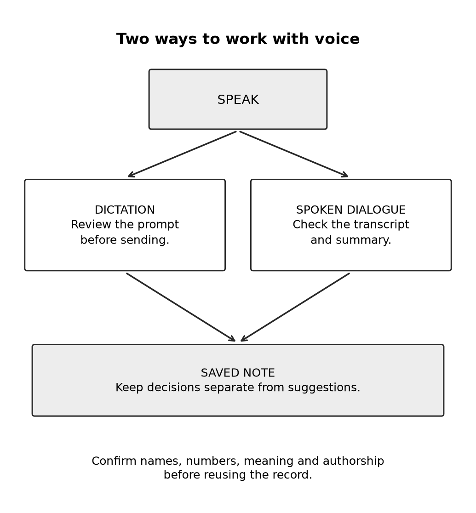

# Chapter 4 practice guide

Think out loud with voice

## Objective

Use dictation and spoken dialogue deliberately, check what was captured, and turn a conversation into a reliable working note.

## Inputs

Use your own harmless notes or the self-contained fictional example in the chapter. Live product setup is not preconfigured by this guide.

## Practice and assessment

Explain one idea aloud for two minutes. Review the transcript, then ask for a short outline. Record one phrase worth preserving and one correction needed to protect your meaning.

**Change one condition:** Use a fictional name and two similar numbers. Did either change? Check them directly rather than asking Claude whether the transcription is accurate.

**Keep:** Your corrected source note, the AI outline, and a sentence about whether voice helped this task. The book's prediction that voice will grow remains a forecast; this small trial gives you evidence about your own use.

**Extended description:** Voice can produce a reviewed prompt or a checked conversation record. Both routes need a saved note that distinguishes decisions from suggestions.

## Record the attempt

Record date, product, interface, model shown, relevant settings, input version, actual output, checks, corrections, and unresolved questions. Do not put account identifiers or authentication material in the record.

Status: exercise design; live Claude execution and human learning trial not performed. The separate maintenance reference test log covers only that local program.
