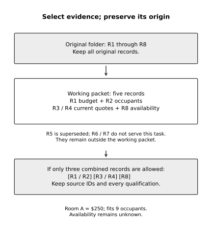

# Chapter 10 practice guide

Work within context and usage limits

## Objective

Select useful context, prepare a handoff, and separate working-space limits from usage allowances and cost.

## Inputs

- [Everyday collaboration and repair](../collaboration-lab/README.md)
- [event-brief.txt](../shared/event-brief.txt)

## Practice and assessment

You must compare two fictional rooms using a packet of at most six short records. This is a teaching constraint, not a model's token limit. Your source folder contains: R1, a $300 spending cap; R2, a requirement for nine occupants including staff; R3, Room A's $200 fee plus $50 mandatory cleaning, capacity ten; R4, Room B's $220 all-inclusive fee, capacity eight; R5, a superseded Room A quote; R6, an old invitation; R7, a draft thank-you note; and R8, a note that neither room's availability is confirmed. All amounts include tax, and no other costs apply in this exercise.

Select the records needed for a recommendation. R1, R2, R3, R4, and R8 support the decision in five records. Preserve the other originals outside the task packet. Room A fits the budget at $250 and the capacity requirement with one spare place, but availability remains unresolved. Room B is cheaper but too small. The cheapest option is not automatically eligible.

**Change one condition:** Your packet budget drops to three records. You may combine records while preserving their source IDs and every necessary qualification. One workable arrangement is requirements R1/R2, quotes R3/R4, and availability R8. Inspect the compressed packet against the originals. If the cleaning charge disappears, the shorter packet has lost evidence. If combination is forbidden, identify the constraint conflict instead of quietly discarding a requirement.

**Extended description:** The working packet selects R1, R2, R3, R4 and R8 while retaining the source archive separately. Compression may combine their wording into three records, but must preserve identifiers, qualifications and unresolved facts. Fewer records alone do not prove that the packet still supports the task.

*Figure 10.1. Select and compress the fictional room evidence without treating a shorter packet as permission to drop a requirement.*

**Keep:** The selected packet, a source-to-packet map, the recommendation, and a record of any lost qualification you repaired. This exercise tests evidence selection; Chapter 7's project packet tests continuity across sessions.

## Record the attempt

Record date, product, interface, model shown, relevant settings, input version, actual output, checks, corrections, and unresolved questions. Do not put account identifiers or authentication material in the record.

Status: exercise design; live Claude execution and human learning trial not performed. The separate maintenance reference test log covers only that local program.
