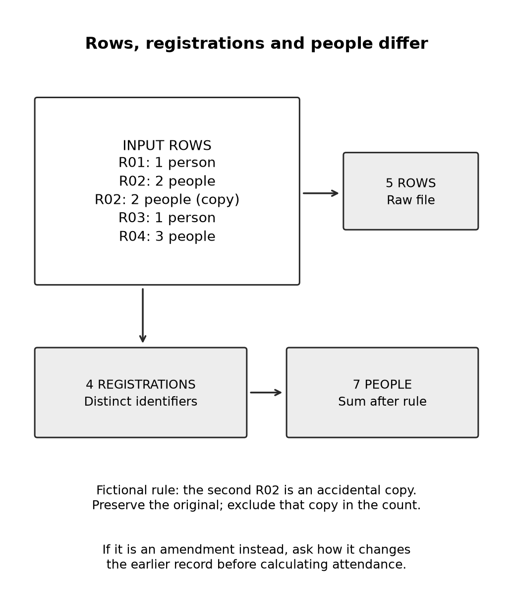

# Chapter 14 practice guide

Read documents images and numbers carefully

## Objective

Check extracted text and data against originals, preserve units, and choose a chart that answers a question.

## Inputs

- [Everyday collaboration and repair](../collaboration-lab/README.md)
- [registrations.csv](../shared/registrations.csv)
- [receipt-clear.png](../chapter-14/receipt-clear.png)
- [receipt-obscured.png](../chapter-14/receipt-obscured.png)
- [receipt-reference.md](../chapter-14/receipt-reference.md)

The receipt reference is an answer key: consult it after the attempt and exclude it from model inputs.

## Practice and assessment

The companion includes `chapter-14/receipt-clear.png` and `receipt-obscured.png`, original fictional receipts rendered for this exercise. They are not purchase records or captured model responses. Open the clear image and extract the item, quantity, unit price, delivery and printed total. You can inspect it yourself first, or use an image-capable environment you are permitted to use. Keep the text receipt and `receipt-reference.md` out of the model prompt; they contain the answers.

Save that attempt before opening the reference. Then repeat using only the obscured image. Its delivery value is deliberately covered. Keep what you can read separate from what arithmetic might imply. Does a total let you claim that you actually saw the covered number? Explain the difference, then compare your answer with `receipt-reference.md`. If image input is unavailable, complete the visual check yourself and mark model extraction untested.

These fixtures test a clear visual source and a completely missing field. They do not establish performance on photographs, handwriting or partially blurred digits.

Extract the registration totals, show the duplicate decision, and independently calculate seven people. Create a small display that distinguishes five input rows, four registrations, and seven people.

**Change one condition:** R02 is now labeled as an amendment. What additional rule do you need before counting? Explain why automatic deduplication is no longer enough.

**Keep:** The original file, cleaned copy, counting rule, and checked display.

**Extended description:** The fictional file contains five rows, four unique registrations, and seven people after the explicitly defined accidental duplicate is removed.

## Record the attempt

Record date, product, interface, model shown, relevant settings, input version, actual output, checks, corrections, and unresolved questions. Do not put account identifiers or authentication material in the record.

Status: exercise design; live Claude execution and human learning trial not performed. The separate maintenance reference test log covers only that local program.
