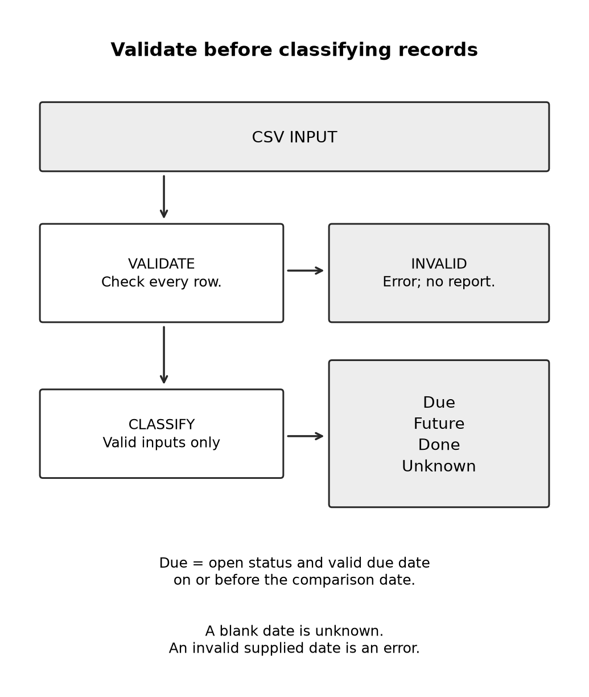

# Chapter 28 practice guide

Build a small tool from a clear brief

## Objective

Build a small tool from acceptance examples and keep its first version narrow enough to inspect.

## Inputs

- [README.md](../builder/maintenance-practice/README.md)

## Practice and assessment

Run the reference tool, then ask Claude Code to build an alternative from the same brief in a separate practice folder. Compare observable behavior rather than requiring identical code.

**Change one condition:** Add a second row with identifier M02. The program should reject the ambiguity before presenting a complete report. Explain why picking the first row silently would be an unsafe default for this data model.

**Keep:** The brief, implementation, acceptance examples, and observed test results. The local reference is a teaching baseline; it is not a production maintenance system or a captured Claude-generated implementation.

**Extended description:** Validate the input before publishing a report. Valid records are classified as due, future, done, or unknown; invalid input produces an error.

## Record the attempt

Record date, product, interface, model shown, relevant settings, input version, actual output, checks, corrections, and unresolved questions. Do not put account identifiers or authentication material in the record.

Status: exercise design; live Claude execution and human learning trial not performed. The separate maintenance reference test log covers only that local program.
