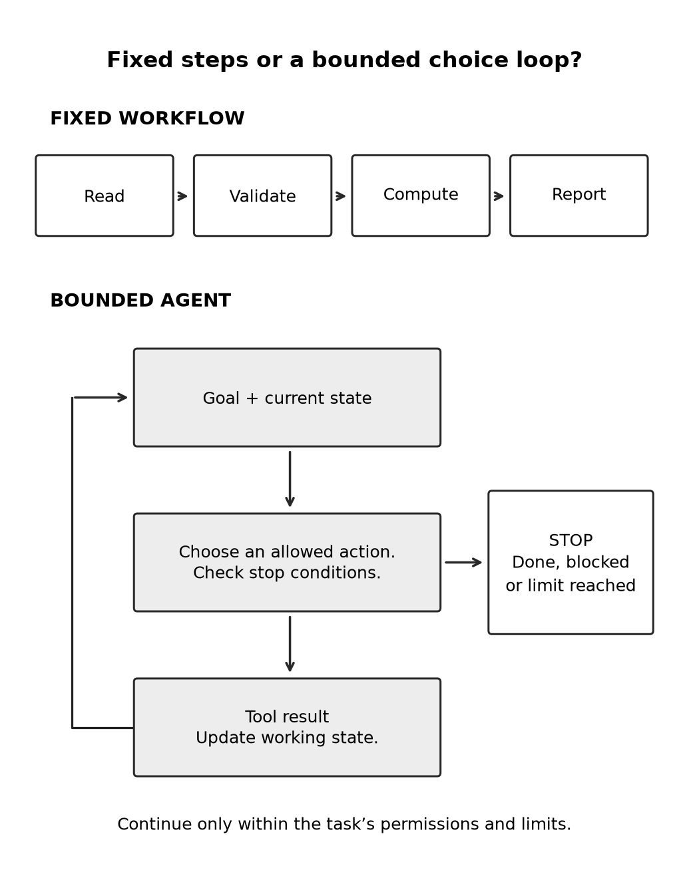

# Chapter 31 practice guide

Choose between a workflow and an agent

## Objective

Choose between a script, a fixed workflow, and an agent by examining the decisions the task requires.

## Inputs

- [README.md](../builder/maintenance-practice/README.md)

## Practice and assessment

Draw both designs for the maintenance report. Mark each decision made by fixed code and each choice left to the model. State why the model needs that choice.

**Change one condition:** All manuals are now standardized and every record includes a verified interval. Reconsider whether the agent is still necessary. A design can become simpler as the problem becomes better defined.

**Keep:** A short decision record explaining the chosen approach and the evidence that would cause you to revisit it.

**Extended description:** A fixed workflow follows predetermined steps. A bounded agent chooses allowed actions and uses their results, stopping when done or blocked.

## Record the attempt

Record date, product, interface, model shown, relevant settings, input version, actual output, checks, corrections, and unresolved questions. Do not put account identifiers or authentication material in the record.

Status: exercise design; live Claude execution and human learning trial not performed. The separate maintenance reference test log covers only that local program.
