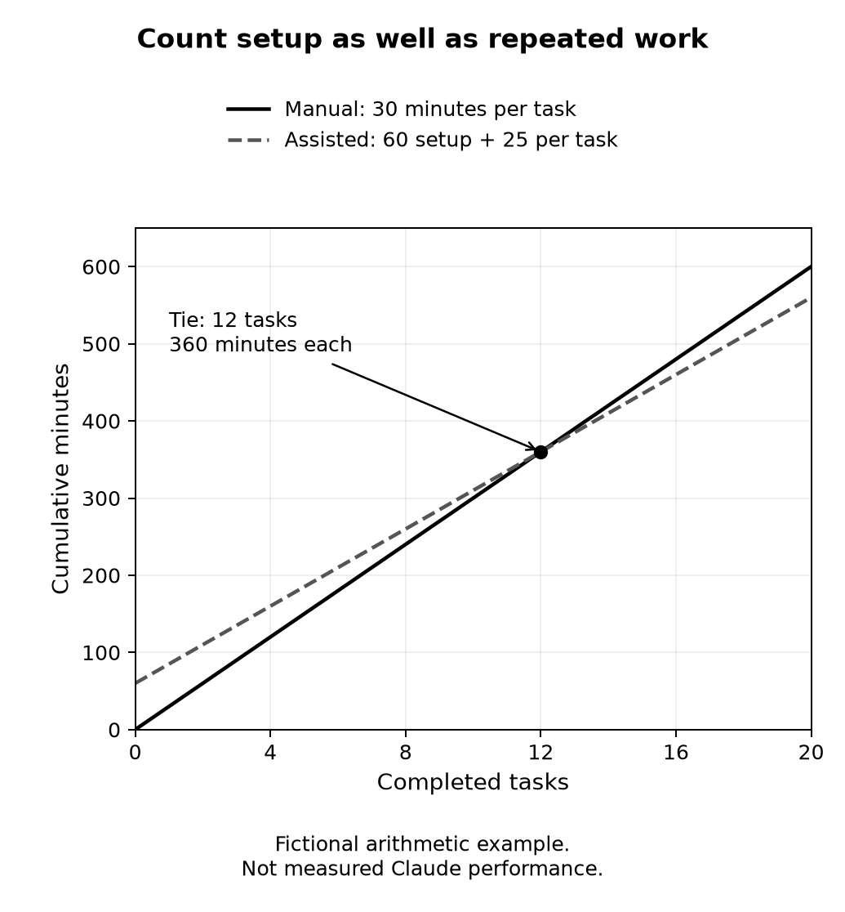

# Chapter 37 practice guide

Measure whether the work is worth doing

## Objective

Measure the whole task, calculate when setup might pay off, and compare quality alongside time.

## Inputs

- [fig-37-01-data.csv](../../figures/prototypes/fig-37-01-data.csv)
- [cost-worksheet.md](../local-ai-lab/cost-worksheet.md)

## Practice and assessment

Measure one low-stakes task using your ordinary method, then a comparable task with Claude. Record the full process and inspect the results against the same criteria. Repeat when practical, without presenting a small sample as a universal conclusion.

**Change one condition:** The task occurs only twice a year and the workflow needs maintenance between runs. Recalculate whether the setup is worthwhile. Choosing not to automate can be a well-supported decision.

**Keep:** The measurements, assumptions, quality checks, and decision. The aim is to spend effort where it helps you, not to prove that every possible use of AI is beneficial.

**Extended description:** Fictional cumulative time is 30 minutes per manual task versus 60 setup minutes plus 25 per assisted task. Both total 360 minutes at twelve tasks. This is not measured Claude performance.

*Figure 37.1. Count setup and repeated work. These fictional totals meet at twelve tasks; they are not measured Claude performance.*

| Completed tasks | Manual minutes | Assisted minutes |
|---|---:|---:|
| 0 | 0 | 60 |
| 6 | 180 | 210 |
| 12 | 360 | 360 |
| 13 | 390 | 385 |
| 20 | 600 | 560 |

All values above are illustrative calculations.

## Record the attempt

Record date, product, interface, model shown, relevant settings, input version, actual output, checks, corrections, and unresolved questions. Do not put account identifiers or authentication material in the record.

Status: exercise design; live Claude execution and human learning trial not performed. The separate maintenance reference test log covers only that local program.
